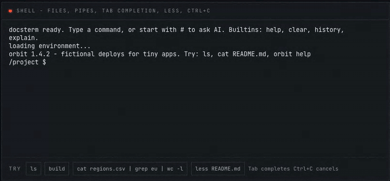

# docsterm

Встраиваемый терминал для страниц документации на xterm.js 6. Читатель выполняет команды прямо на странице — в эмулированной в браузере оболочке, в REPL для JavaScript или Python, в программе на WebAssembly или в настоящей оболочке на вашем сервере, — просит AI превратить запрос в команду (`#задеплой приложение`) и получает объяснение, если команда упала.

English version: [README.md](./README.md) · Рецепты для фреймворков: [docs/embedding.ru.md](./docs/embedding.ru.md) · Изменения: [CHANGELOG.md](./CHANGELOG.md)

**Живое демо:** [docsterm.vercel.app](https://docsterm.vercel.app) (добавьте `?ai=mock`, чтобы попробовать AI без сети) · **npm:** [docsterm](https://www.npmjs.com/package/docsterm)



## Содержание

- [Установка](#установка)
- [Быстрый старт](#быстрый-старт)
- [Что где выполняется](#что-где-выполняется)
- [Справочник](#справочник)
- [Безопасность и ограничения](#безопасность-и-ограничения)
- [Разработка](#разработка)
- [Планы](#планы)
- [Лицензия](#лицензия)

## Установка

```bash
npm install docsterm @xterm/xterm
```

`docsterm` зависит от `@xterm/xterm`, `@xterm/addon-fit`, `@xterm/addon-unicode11` и `acorn`. `@xterm/xterm` стоит добавить и в свои зависимости: ваше приложение импортирует его таблицу стилей, а сам виджет `@xterm/xterm/css/xterm.css` не подключает.

Один пакет, одиннадцать входов. Импортируйте только нужное; необязательный peer-пакет нужен лишь тому входу, который им пользуется.

| Импорт | Что это | Что доустановить |
| --- | --- | --- |
| `docsterm` | Виджет (`DocsTerminal`), кнопки запуска, mock-провайдер AI, темы, сообщения на en/ru, типы | — |
| `docsterm/shell` | POSIX-подобная оболочка над виртуальной файловой системой; ваш CLI становится командой | — |
| `docsterm/javascript` | REPL для JavaScript в Web Worker | — |
| `docsterm/pyodide` | REPL для Python (CPython на Pyodide) в Web Worker | — (среда скачивается с jsDelivr или с вашего `indexURL`) |
| `docsterm/wasi` | Запускает одну программу `wasm32-wasi` (Rust, C, C++, Zig, Go) | ваш файл `.wasm` |
| `docsterm/websocket` | Команды выполняются на вашем сервере через WebSocket | сервер, см. [examples/websocket-server](./examples/websocket-server/README.ru.md) |
| `docsterm/mock` | Заготовленные ответы без вычислений: для туториалов и тестов | — |
| `docsterm/anthropic` | Провайдер AI на Anthropic SDK, ключ читателя | `@anthropic-ai/sdk` (>= 0.50.1) |
| `docsterm/openai` | Провайдер AI для любого OpenAI-совместимого API, чистый `fetch` | — |
| `docsterm/react` | React-компонент `<DocsTerminal>` | `react` (>= 18) |
| `docsterm/element` | Пользовательский элемент `<docs-terminal>` для любого фреймворка и обычного HTML | — |

Любой вход импортируется в Node без DOM (серверная сборка Docusaurus, Next.js, VitePress и Astro), у пакета `"sideEffects": false`. Типы находятся при разрешении модулей `bundler`, `nodenext` и `node10`; типам React нужен TypeScript 4.4 или новее.

## Быстрый старт

Задайте контейнеру высоту: терминал заполняет его и подстраивается при изменении размера.

```ts
import '@xterm/xterm/css/xterm.css'
import { DocsTerminal } from 'docsterm'
import { createShellBackend } from 'docsterm/shell'

const terminal = new DocsTerminal({
  backend: createShellBackend({
    cwd: '/project',
    files: { project: { 'README.md': '# demo app\n', src: { 'index.ts': 'export const answer = 42\n' } } },
  }),
  theme: 'auto',
})

const container = document.querySelector<HTMLElement>('#terminal')
if (container) await terminal.mount(container)
```

React (бэкенд должен быть постоянным, см. [React](docs/reference.ru.md#react)):

```tsx
import '@xterm/xterm/css/xterm.css'
import { useState } from 'react'
import { DocsTerminal } from 'docsterm/react'
import { createPyodideBackend } from 'docsterm/pyodide'

export function PythonTutorial() {
  const [backend] = useState(() => createPyodideBackend())
  return <DocsTerminal backend={backend} theme="auto" style={{ height: 320 }} />
}
```

В любом другом фреймворке и в обычном HTML — пользовательский элемент:

```html
<docs-terminal backend="shell" theme="auto" style="height: 280px"></docs-terminal>
```

```ts
import '@xterm/xterm/css/xterm.css'
import { defineDocsTerminal } from 'docsterm/element'

defineDocsTerminal()
```

Рецепты для Docusaurus, Next.js, Vue/VitePress, Astro/Starlight, обычного HTML с import map и Vite: [docs/embedding.ru.md](./docs/embedding.ru.md).

## Что где выполняется

Вкладка браузера — не Linux-машина. Всё, что написано на JavaScript или скомпилировано в WebAssembly, работает на компьютере читателя; всему, чему нужно ядро (Docker, systemd, настоящие процессы), нужна машина, которой управляете вы.

| Что документируете | Где выполняется | Как |
| --- | --- | --- |
| Собственный CLI (`orbit`, `stripe`, `supabase`…) | браузер читателя | `docsterm/shell`, CLI зарегистрирован как команда |
| Основы оболочки (`ls`, `grep`, конвейеры, перенаправления) | браузер читателя | `docsterm/shell`, 33 встроенные команды |
| SDK для JavaScript или TypeScript | браузер читателя | `docsterm/javascript` |
| Библиотеку на Python | браузер читателя | `docsterm/pyodide`, `pip install` для pure-Python-пакетов |
| Программу на Rust, C, C++, Zig или Go | браузер читателя | `docsterm/wasi`, сборка под `wasm32-wasip1` |
| Ruby, PHP, Lua, SQLite | браузер читателя | свой `Backend` поверх `ruby.wasm`, `php-wasm`, `wasmoon`, `sql.js`… |
| Docker, git, kubectl, npm, настоящую оболочку Linux | ваш сервер | `docsterm/websocket` и [сервер-образец](./examples/websocket-server/README.ru.md) |
| Node.js в браузере | — | не поддерживается |

## Справочник

- [Бэкенды](docs/reference.ru.md#бэкенды) — Шесть бэкендов, таблица возможностей и опции каждого
- [Терминал](docs/reference.ru.md#терминал) — Клавиши, история, дополнение, постраничник less, Ctrl+C
- [Провайдеры AI](docs/reference.ru.md#провайдеры-ai) — Anthropic, OpenAI-совместимые endpoint-ы, локальные модели, ключи и ошибки
- [Управляющий API](docs/reference.ru.md#управляющий-api) — Методы, события и отчёты о запусках терминала
- [Кнопки запуска](docs/reference.ru.md#кнопки-запуска) — Превратить блоки кода страницы в кнопки запуска
- [React](docs/reference.ru.md#react) — Компонент `<DocsTerminal>` и стабильный бэкенд
- [Элемент `<docs-terminal>`](docs/reference.ru.md#элемент-docs-terminal) — Пользовательский элемент для любого фреймворка и обычного HTML
- [Опции виджета](docs/reference.ru.md#опции-виджета) — Все опции виджета
- [Свой бэкенд](docs/reference.ru.md#свой-бэкенд) — Контракт `Backend`, интерактивные программы
- [Content-Security-Policy](docs/reference.ru.md#content-security-policy) — Что каждому бэкенду нужно от политики страницы
- [Языки и темы](docs/reference.ru.md#языки-и-темы) — Сообщения на английском и русском, темы

## Безопасность и ограничения

- **Воркеры работают от имени вашего источника.** Воркеры JavaScript и Python обладают правами источника документации: код, который набирает читатель, может обращаться к URL того же источника с куками сайта, читать и менять его IndexedDB и Cache Storage. Если документация делит источник с приложением, которое опирается на куки, отдавайте терминалы JavaScript и Python с источника без этих кук.
- **Регулярные выражения в оболочке.** `grep -E` и `grep -P` работают в основном потоке страницы без ограничения времени; шаблон с катастрофическим перебором с возвратами подвешивает вкладку.
- **Pyodide с CDN** загружается без проверки целостности. В продакшене размещайте его у себя и указывайте `indexURL`.
- **WASI на странице.** `worker: false` или свой `instantiate` блокируют страницу, пока программа работает, а вычислительный цикл остановить нельзя.
- **Ключи AI** лежат в `localStorage` читателя, где их может прочитать любой скрипт с вашего источника; см. [Ключи, ошибки и ответы](docs/reference.ru.md#ключи-ошибки-и-ответы).
- **Подсказки AI** никогда не выполняются без `y`; из них удаляются управляющие последовательности, они отвергаются, если содержат невидимые символы или не помещаются на экране, а нажатия до появления вопроса отбрасываются. Вставленные строки с `#` до AI не доходят.
- **Серверы.** Бэкенд WebSocket даёт незнакомцам набирать команды на вашей машине. Начните с [сервера-образца](./examples/websocket-server/README.ru.md): он запускает каждый сеанс от непривилегированного пользователя в Docker-контейнере без сети, с ограничениями процессора, памяти и числа процессов, — и прочтите его раздел о безопасности: для публичного развёртывания там рекомендуют gVisor или переназначение пространств имён пользователей (userns-remap).
- **Аналитика.** События и отчёты о запуске могут содержать секреты, которые ввёл читатель; см. примечание о приватности в разделе [Управляющий API](docs/reference.ru.md#управляющий-api).

## Разработка

```bash
pnpm install
pnpm build                          # собирает packages/docsterm/dist (в .dist-next, на место dist — только при успехе)
pnpm --filter docsterm-demo dev     # демо, оно берёт библиотеку из dist
pnpm typecheck
pnpm lint
pnpm test                           # юнит-тесты vitest
pnpm test:scripts                   # node:test для scripts/
pnpm coverage
pnpm exec playwright install chromium   # один раз
pnpm e2e                            # собирает библиотеку и демо и запускает Playwright на порту 4179
pnpm probe                          # пакует библиотеку и проверяет её в чистых проектах (нужен реестр npm)
node scripts/sync-readme.mjs        # заново создаёт packages/docsterm/README.md из README.md
```

Демо понимает `?ai=mock` (AI без сети), `?locale=en` или `?locale=ru`, `?theme=light` или `?theme=dark` и `?isolated`: с ним серверы разработки и предпросмотра отдают заголовки межсайтовой изоляции, и Python сохраняет переменные после Ctrl+C; `/react.html` — проверочная страница для React. Набор e2e запускает Python без сети из `node_modules/pyodide`; сеть (`cdn.jsdelivr.net`, `pypi.org`) нужна только тесту `pip install`.

Репозиторию нужен Node.js 22.22.2+, 24.15+ или 26 и pnpm 11.22. У сервера-образца для WebSocket свой [README](./examples/websocket-server/README.ru.md).

## Планы

- Бэкенд Node.js (зрелой открытой песочницы Node.js для браузера пока нет)
- Пошаговый режим туториала с проверкой вывода
- Чтение ввода с клавиатуры в программах Pyodide и WASI (нужна межсайтовая изоляция)
- Аналитика мест, где читатели застревают

## Лицензия

MIT © [Surdeddd](https://github.com/Surdeddd)
